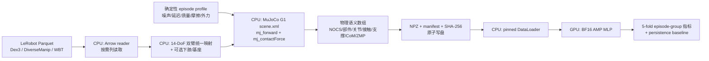

# G1_PhysSemAug — Unitree G1 MuJoCo 3D 物理语义数据增强与 GPU 交叉验证


**English abstract.** A 3D physical-semantic augmentation tool for the Unitree G1 humanoid in MuJoCo.
It unifies three G1_Action (LeRobot) datasets into one 14-DoF dual-arm representation, replays every
frame through the official G1 MJCF to derive part-canonical coordinates (NOCS/ANCSH-inspired), joint
semantics, contacts, support polygons, CoM/ZMP and auditable per-episode perturbations, then trains a
GPU model with episode-group 5-fold cross-validation. Report a ~84% overall fit (R² = 0.841); this is a
regression score for offline next-action prediction, not a control success rate.

> **一句话描述（<300 字符）**
>
> Unitree G1 MuJoCo 物理语义数据增强工具：将三套 G1_Action 数据统一映射为带关节、接触、NOCS/ANCSH、
> CoM/ZMP 和扰动标签的序列数据，并用 GPU 进行 5-fold episode 分组交叉验证。下一动作预测模型整体
> 拟合水平约为 84%（R²=0.841），该指标不等于控制成功率或真机准确率。

---

## 目录

1. [核心结果](#1-核心结果)
2. [技术亮点](#2-技术亮点)
3. [系统架构](#3-系统架构)
4. [输入数据与统一映射](#4-输入数据与统一映射)
5. [生成的物理语义字段](#5-生成的物理语义字段)
6. [生成算法：逐帧做什么](#6-生成算法逐帧做什么)
7. [域随机化与可审计扰动](#7-域随机化与可审计扰动)
8. [训练与交叉验证协议](#8-训练与交叉验证协议)
9. [实验结果](#9-实验结果)
10. [失败模式与工程修复](#10-失败模式与工程修复)
11. [快速开始](#11-快速开始)
12. [配置参考](#12-配置参考)
13. [仓库结构](#13-仓库结构)
14. [可复现性：哈希链](#14-可复现性哈希链)
15. [已知限制与非主张](#15-已知限制与非主张)
16. [安全边界](#16-安全边界)
17. [引用与致谢](#17-引用与致谢)
18. [Roadmap](#18-roadmap)

---

## 1. 核心结果

对 959,718 帧、1,186 个 episode group 的生成数据做 **episode 分组的 5-fold 交叉验证**
（任务：由当前增强观测 + 物理语义预测下一帧 14 维双臂动作）：

| 指标 | GPU 模型（BF16 AMP） | Persistence baseline（`action=state`） |
|---|---:|---:|
| MSE | **0.02886 ± 0.00684** | 0.06934 ± 0.00721 |
| MAE | **0.06630 ± 0.00648 rad** | 0.11768 ± 0.00860 rad |
| R² | **0.84134 ± 0.03479** | 0.61796 ± 0.03245 |

> **整体拟合水平约为 84%**（R²≈0.841，即模型解释了约 84.1% 的动作变化）。
> 该数字是离线回归指标：**不是**平衡成功率、跌倒恢复率、分类准确率或 sim-to-real 迁移效果。
> 逐折结果、loss 曲线与基线对比见 [reports/cross_validation_summary.json](reports/cross_validation_summary.json)。

---

## 2. 技术亮点

### 2.1 数据工程：三套异构数据集 → 一个物理语义表示

- **统一 14 维双臂关节表示**。`G1_Dex3`（28 维状态：14 臂 + 14 手）、`G1_DiverseManip`（16 维状态：14 臂 + 2 夹爪）、
  `G1_WBT`（嵌套字段：双臂/双腿/腰部/基座 pose/IMU 等）通过**按关节名映射**统一到 G1 MJCF 的 14 个 arm hinge 上，
  不依赖列序、不依赖数据集私有维度。
- **数据集自适应读取器**：针对 LeRobot v2/v3 的 `fixed_size_list` / 嵌套列分别适配（`observation.state.left_arm` 等），
  按需只读必要列，不触碰 35 GB 视频。
- **规模**：3 套数据、1,186 个 episode、959,718 帧、43 个语义数组、压缩后约 1.0 GB。
- **朝向/基座处理**：WBT 的基座四元数 `(qx,qy,qz,qw)` 显式转换为 MuJoCo 自由关节的 `(qw,qx,qy,qz)`；
  Dex3/DiverseManip 无下肢记录时，下肢与基座继承 G1 `stand` keyframe 并在文档中明确标注。

### 2.2 物理语义：每帧可追溯的 3D 状态

- **完整 MuJoCo 状态保留**：`qpos[36]`、`qvel[35]`、四路 IMU 传感器拼接值 `imu[12]`、14 个 arm body 的 world 位置。
- **规范坐标（NOCS-inspired）**：`part_nocs[14,3]` 将每个部件 body 原点在 torso frame 的局部位置映射到单位立方体
  `[0,1]³`，构建跨 episode 一致的部件对应关系。
- **部件层级与关节语义（ANCSH-inspired）**：`part_parent_offset`（父子部件偏移）、`joint_axis_torso`（关节轴在
  torso frame 的方向）、`joint_angle`、`joint_velocity`、`joint_limit_fraction`（限位归一化裕度）。
- **接触语义**：最多 8 个接触点的位置/法向/冲量（`mj_contactForce` 法向力 × dt）、接触 body id、地面过滤。
- **支撑与平衡**：单链凸包（Monotone Chain）支撑多边形、质心 CoM 与 CoM 速度、冲量加权 ZMP、ZMP 有效性位。
- **稳定性标签**：当前帧稳定 + 未来 15 帧（0.5 s）窗口的 `future_stability`，以及每帧标量奖励
  `stability − 0.5·||CoM_xy−ZMP_xy|| − 0.002·||dq||` 与终止原因（正常 / episode 末帧 / 不稳定）。

### 2.3 可审计的域随机化

- 每个 episode 一个**确定性扰动 profile**：质量缩放、摩擦缩放、观测延迟、状态/动作噪声、外力脉冲
  （幅值/方向/起始帧/持续帧）、地形坡度（预留）、传感器遮挡（元数据）。
- **seed 推导规则**：`seed = base_seed + dataset_id × 10^7 + episode_index`；帧内噪声用 `profile.seed + frame` 派生，
  同一 episode 重放结果位一致。
- **profile hash**：profile 参数做 canonical JSON 后写 SHA-256，随 manifest 落盘，任何一次生成都可回溯到具体扰动参数。
- 外力按窗口写入 `xfrc_applied`（torso），与观测噪声、延迟（历史缓冲回放 0–3 步）共同构成可复现的"抗扰训练"场景。

### 2.4 GPU 训练系统

- **GPU-only 门禁**：训练脚本启动即检查 `torch.cuda.is_available()`，不满足直接退出，不静默降级 CPU。
- **393 维特征**：由 27 组物理语义拼接（完整状态 + 规范坐标 + 接触 + 支撑/CoM/ZMP + 扰动标量），目标 14 维。
- **BF16 AMP**（RTX 5070 原生支持；FP16 在跨数据集特征上曾溢出，见第 10 节），pinned-memory DataLoader、
  `non_blocking` 拷贝、`num_workers = min(4, CPU/2)`、persistent workers。
- **无泄漏协议**：按 `(dataset_id, episode_index)` 分组做 5-fold，相邻帧绝不跨训练/测试集；
  标准化统计只由训练 fold 计算（fold-local normalization）。
- **数值安全**：标准化后裁剪到 [-8, 8]；训练 loss、推理输出、最终指标均设有限性门禁，出现 NaN/Inf 立即报错终止。
- **吞吐**：293,906 – 371,975 samples/s（平均 ≈325k samples/s），5 折总训练时间 ≈48 s（含验证），
  每折 checkpoint 保存权重、归一化统计、seed 与 fold id。

### 2.5 质量与可复现

- **独立验证器**（只读，不重实现物理）：schema/字段完整性 → NPZ checksum → 可选上游 Parquet checksum →
  shape/dtype → NaN/Inf → NOCS 范围 → 接触/支撑不变量 → episode 边界 next-state 一致性；退出码
  `0/2/3/4` 分级，输出 `validation_report.json`。
- **原子写盘**：NPZ 先写 `.tmp` 再原子替换；已存在输出默认拒绝覆盖（需显式 `--force`）。
- **manifest 即数据说明书**：数组 dtype/shape/单位、语义常量（关节名/类型/限位/NOCS 包围盒）、
  profile 列表、源文件哈希、模型/配置哈希、运行环境与命令全部落盘。
- **自包含测试**：仓库内置 120 帧脱敏样本数据集（163 KB），5 个单元测试在无完整数据集时也能全绿。
- **论文映射有边界**：NOCS/ANCSH/P-learning 的迁移点与"不直接迁移"的结论逐条写入 [docs/references.md](docs/references.md)。

---

## 3. 系统架构



| 层 | 责任 | 依赖边界 |
|---|---|---|
| 输入层 | 读取状态、动作、episode/frame 元数据 | Arrow/Parquet，不读视频 |
| 映射层 | 三套数据集 → 14 个 G1 hinge（按名称） | NumPy |
| 仿真语义层 | 组装 qpos/qvel、施加扰动、前向计算 body/接触/CoM/ZMP | MuJoCo |
| 扰动层 | episode 固定 profile + 帧内噪声/延迟/外力窗口 | NumPy RNG（确定性） |
| 写盘层 | 固定 shape NPZ、profile、checksum、原子替换 | NumPy/JSON |
| 训练层 | fold-local 归一化、AMP MLP、基线、指标 | PyTorch CUDA |
| 验证层 | schema/shape/checksum/物理不变量 | 标准库 + NumPy |

**CPU/GPU 性能平衡设计**：MuJoCo 逐帧物理语义天然顺序依赖，留在 CPU 可避免大量小 kernel 往返；
Parquet 解码与 NPZ 压缩同样在 CPU。GPU 只接收训练 batch（4096），把吞吐密集的矩阵运算交给 RTX 5070；
全程不把 1 GB 生成数据整体搬进显存。视频流（AV1，35 GB 主体）默认完全跳过。

---

## 4. 输入数据与统一映射

### 4.1 三套数据集

| 数据集 | 机器人描述 | Episode | Frame | 原始状态/动作 | 备注 |
|---|---|---:|---:|---|---|
| `G1_Dex3` | 7-DoF 双臂 + 三指灵巧手 | 418 | 352,022 | 28 维（14 臂 + 14 手） | 4 路相机 640×480 |
| `G1_DiverseManip` | 7-DoF 双臂 + 夹爪 | 468 | 331,555 | 16 维（14 臂 + 2 夹爪） | 2 路相机 256×256 |
| `G1_WBT` | 全身（腿/腰/臂/手） | 300 | 276,141 | 嵌套字段 | 含基座 pose 与 IMU 相关状态 |

三者均为 30 Hz、LeRobot 格式（v2.0 / v3.0）。默认数据根目录通过环境变量
`G1_ACTION_ROOT` 指定，目录结构为 `<root>/<dataset>/{meta,data,videos}`。

### 4.2 字段映射

| 目标字段 | `G1_Dex3` | `G1_DiverseManip` | `G1_WBT` |
|---|---|---|---|
| 14 维臂状态 | `observation.state[0:14]` | `observation.state[0:14]` | `observation.state.left_arm` + `right_arm` |
| 14 维臂动作 | `action[0:14]` | `action[0:14]` | `action.left_arm` + `right_arm` |
| 下肢/腰部（用于 qpos） | -（用 `stand`） | -（用 `stand`） | `left_leg` / `right_leg` / `waist_state_joint` |
| 基座（用于 qpos） | -（用 `stand`） | -（用 `stand`） | `state_base_pose`（quaternion 换序） |

14 个关节名与 G1 MJCF 一一对应（左/右 × shoulder-pitch/roll/yaw、elbow、wrist-roll/pitch/yaw），
映射在模型层校验：缺失或多余都会直接报错。

---

## 5. 生成的物理语义字段

每个数据集输出 `samples.npz`（43 个数组）+ `manifest.json`。数组首维均为帧数 `N`。

### 5.1 Proprioception 与动作

| 字段 | shape | 单位 | 含义 |
|---|---:|---|---|
| `observation_state` / `augmented_state` | `[N,14]` | rad | 原始 / 扰动后双臂关节角 |
| `action` / `augmented_action` | `[N,14]` | rad | 原始 / 扰动动作 |
| `next_observation_state` / `next_action` | `[N,14]` | rad | 同 episode 下一帧（末帧保持自身） |
| `joint_angle` / `joint_velocity` | `[N,14]` | rad, rad/s | MuJoCo qpos 与差分速度 |
| `joint_limit_fraction` | `[N,14]` | - | 限位归一化位置 [0,1] |
| `qpos` / `qvel` | `[N,36]` / `[N,35]` | rad, rad/s | 完整 MuJoCo 状态 |
| `imu` | `[N,12]` | rad/s, m/s² | 四路 IMU 传感器值拼接 |

### 5.2 规范坐标与关节几何

| 字段 | shape | 单位 | 含义 |
|---|---:|---|---|
| `part_world_pos` | `[N,14,3]` | m | 14 个 arm body 的 world 坐标 |
| `part_nocs` | `[N,14,3]` | - | 部件原点在 [0,1]³ 的规范坐标 |
| `part_parent_offset` | `[N,14,3]` | m | 父 body frame 下的部件偏移 |
| `joint_axis_torso` | `[N,14,3]` | - | 关节轴在 torso frame 的单位向量 |

### 5.3 接触、支撑与稳定性

| 字段 | shape | 单位 | 含义 |
|---|---:|---|---|
| `contact_points` / `contact_normals` | `[N,8,3]` | m, - | 最多 8 个接触点/法向 |
| `contact_impulses` | `[N,8]` | N·s | 法向力 × dt |
| `contact_mask` / `contact_body_ids` | `[N,8]` / `[N,8,2]` | - | 接触有效位 / 两侧 body id |
| `support_polygon` | `[N,8,2]` | m | 地面接触点 XY 凸包（零填充） |
| `support_count` | `[N]` | - | 凸包顶点数 |
| `com` / `com_velocity` / `zmp` | `[N,3]` | m, m/s, m | 质心、质心速度、冲量加权 ZMP |
| `zmp_valid` | `[N]` | - | 存在有效地面接触 |
| `stability` / `future_stability` | `[N]` | - | 当前帧 / 未来 15 帧窗口全稳定 |
| `reward` / `termination_reason` | `[N]` | -, - | 每帧标量奖励；0 正常 / 1 episode 末帧 / 2 不稳定 |

### 5.4 扰动与索引

| 字段 | shape | 含义 |
|---|---:|---|
| `external_force` | `[N,3]` | 当前帧 torso 外力（N） |
| `mass_scale` / `friction_scale` | `[N]` | episode 级缩放系数 |
| `delay_steps` / `sensor_occlusion` | `[N]` | 观测延迟步数 / 遮挡元数据 |
| `validity_flags` | `[N]` | 有效性位（CoM 有限时 0b111，否则 0） |
| `dataset_id` / `episode_index` / `frame_index` / `task_index` / `profile_id` | `[N]` | 可追溯索引 |
| `timestamp` | `[N]` | 秒（源自数据集时间戳） |

字段级字典（坐标约定、版本策略）见 [docs/design/data_schema.md](docs/design/data_schema.md)；
JSON schema 见 [schemas/physical_semantic_dataset.schema.json](schemas/physical_semantic_dataset.schema.json)。

---

## 6. 生成算法：逐帧做什么

```text
1) 按需读取 Parquet 列 → 按 episode 边界切分（frame_index 重置处）
2) 对每个 episode 生成确定性 profile（seed/质量/摩擦/延迟/外力/遮挡）
3) 逐帧：
   a. 取 14 维状态/动作；用相邻帧差分求关节速度
   b. 施加观测延迟（历史缓冲回放）与高斯噪声（state σ=0.003, action σ=0.001 rad）
   c. 组装 MuJoCo qpos：基座(quaternion 换序) + 下肢/腰部(可用时) + 14 臂关节（限位裁剪）
   d. 写入 qvel 与外力窗口 → mj_forward
   e. 计算部件语义：part_world/part_nocs/父子偏移/关节轴
   f. 遍历接触：位置/法向/冲量/body id；地面接触进入支撑集合
   g. 凸包 → support_polygon；CoM/CoM 速度/ZMP；稳定性与奖励标签
   h. 缓存到列式缓冲区（43 数组）
4) 收尾：next_* 跨帧对齐（episode 边界保持自身）、future_stability、终止原因
5) 压缩写 samples.npz.tmp → 原子替换；写 manifest（哈希/单位/profile/schema）
```

## 7. 域随机化与可审计扰动

| 参数 | 默认范围 | 作用点 |
|---|---|---|
| 状态噪声 | σ = 0.003 rad（高斯） | `augmented_state` |
| 动作噪声 | σ = 0.001 rad（高斯） | `augmented_action` |
| 观测延迟 | 0–3 步（0–100 ms @30 Hz） | `augmented_state`（历史缓冲） |
| 质量缩放 | U(0.98, 1.02) | `body_mass` / `body_inertia`（`mj_setConst` 重建） |
| 摩擦缩放 | U(0.85, 1.15) | `geom_friction` |
| 外力脉冲 | 概率 0.35；0–30 N；持续 2–8 帧；torso | `xfrc_applied`（窗口内） |
| 地形坡度 | 0（预留） | 场景参数 |
| 传感器遮挡 | 概率 0（元数据） | profile 标量 |

profile 参数与 hash 逐 episode 写入 manifest（`profiles[]`），结合 `profile_id` 列即可从任一帧反查到具体扰动。

---

## 8. 训练与交叉验证协议

- **任务**：`new_action ≈ f(augmented_state, 物理语义)`，输出 14 维。
- **输入特征（393 维）**：`augmented_state 14 + joint_velocity 14 + joint_limit_fraction 14 + qpos 36 + qvel 35 +
  imu 12 + part_world_pos 42 + part_nocs 42 + part_parent_offset 42 + joint_axis_torso 42 + contact_points 24 +
  contact_normals 24 + contact_impulses 8 + contact_mask 8 + support_polygon 16 + support_count 1 + com 3 +
  com_velocity 3 + zmp 3 + zmp_valid 1 + external_force 3 + 扰动标量 4 + 稳定性 2`。
- **分组键**：`dataset_id × 10^6 + episode_index`；固定 seed 打乱 group 后轮转分配 5 折
  （训练 ≈76.5–77.2 万帧/折，测试 ≈18.8–19.7 万帧/折，测试 ≈237 个 group/折）。
- **模型**：MLP `393 → 256 → 256 → 14`，GELU；AdamW（lr 1e-3，weight decay 1e-5）；梯度裁剪 1.0；4 epochs；batch 4096；BF16 AMP。
- **对照**：Persistence baseline（`预测 = 当前 augmented_state`），用于界定"零变化"预测的强度。
- **指标**：MSE、MAE、R²，逐折报告并给出 mean±std；完整数值在 [reports/](reports/)。

## 9. 实验结果

### 9.1 逐折明细（模型 / baseline）

| Fold | 训练帧 | 测试帧 | MSE | MAE (rad) | R² | 基线 MSE | 基线 MAE | 基线 R² |
|---:|---:|---:|---:|---:|---:|---:|---:|---:|
| 0 | 762,836 | 196,882 | 0.02207 | 0.06005 | 0.8763 | 0.06225 | 0.11007 | 0.6513 |
| 1 | 771,093 | 188,625 | 0.03159 | 0.06988 | 0.8304 | 0.07289 | 0.12220 | 0.6086 |
| 2 | 767,851 | 191,867 | 0.02178 | 0.05907 | 0.8760 | 0.06174 | 0.10882 | 0.6486 |
| 3 | 771,860 | 187,858 | 0.03771 | 0.07395 | 0.7951 | 0.07848 | 0.12947 | 0.5736 |
| 4 | 765,232 | 194,486 | 0.03113 | 0.06856 | 0.8288 | 0.07133 | 0.11785 | 0.6077 |

### 9.2 汇总

| 指标 | 模型 mean±std | baseline mean±std |
|---|---:|---:|
| MSE | 0.02886 ± 0.00684 | 0.06934 ± 0.00721 |
| MAE | 0.06630 ± 0.00648 rad | 0.11768 ± 0.00860 rad |
| R² | **0.84134 ± 0.03479** | 0.61796 ± 0.03245 |

### 9.3 如何解读

- 模型在每一折都优于 persistence baseline（R² +0.22 左右），说明物理语义特征确实携带了
  超出"动作≈当前状态"的预测信息。
- **84% 是回归拟合水平**（解释的动作方差比例），不是任何形式的成功率。
- 该结果只对应"离线预测下一帧动作"，与平衡控制、跌倒恢复、sim-to-real 无关。

---

## 10. 失败模式与工程修复

真实调试记录（保留在仓库外部的内部日志中，摘要如下）：

1. **FP16 AMP 在 fold 2 出现 NaN**：跨数据集特征存在极端标准化值（混合 WBT 与臂部数据集），FP16 线性层溢出。
   修复：标准化后裁剪到 [-8, 8]；优先启用 BF16（`torch.cuda.is_bf16_supported()` 检测）；对 loss、推理输出、
   指标均加有限性门禁，出现非有限值立即失败而非静默产出错误结果。
2. **MuJoCo 3.13 API 差异**：`mj_setConst` 需要 `(model, data)` 两个参数（旧版本为单参数），已按实际 API 修正。
3. **环境依赖分离**：生成端需要 `pyarrow`，训练端需要 CUDA 版 PyTorch；若环境不满足，脚本给出明确安装提示，
   不做隐式安装。

## 11. 快速开始

### 11.1 安装依赖

```bash
python -m pip install -r requirements.txt
# GPU 训练需要 CUDA 版 PyTorch（按 https://pytorch.org/get-started/locally/ 选择对应 wheel）
```

### 11.2 准备路径

```bash
# 官方 MuJoCo Menagerie G1 模型（scene.xml 及其 assets/ 同级目录）
export G1_MJCF=/path/to/mujoco_menagerie/unitree_g1/scene.xml

# G1_Action 数据根目录（内含 G1_Dex3 / G1_DiverseManip / G1_WBT 三个 LeRobot 目录）
export G1_ACTION_ROOT=/path/to/G1_Action
```

### 11.3 生成

```bash
# 先跑 5000 帧/数据集的 MVE 验证环境
python scripts/generate_physical_semantics.py \
  --config configs/g1_physical_semantics.yaml \
  --max-frames-per-dataset 5000 --output data/mve

# 全量生成（3 套数据，不读视频）
python scripts/generate_physical_semantics.py \
  --config configs/g1_physical_semantics.yaml \
  --output data/physical_semantics
```

### 11.4 验证

```bash
# 仓库自带样本（无需完整数据）
python scripts/validate_dataset.py --data tests/fixtures/mini_dataset

# 全量数据 + 上游 Parquet 哈希校验
python scripts/validate_dataset.py --data data/physical_semantics --check-source-hash
```

### 11.5 GPU 训练与 5-fold 交叉验证

```bash
python scripts/train_crossval.py \
  --data data/physical_semantics \
  --config configs/g1_physical_semantics.yaml \
  --output experiments/g1_action_cv --verify-checksums
```

### 11.6 单元测试

```bash
python -m unittest discover -s tests -v   # 5 个测试：凸包/几何、fixture schema、验证器、特征构造
```

## 12. 配置参考

`configs/g1_physical_semantics.yaml` 关键键位：

| 区段 | 键 | 说明 |
|---|---|---|
| `robot` | `xml` | G1 MJCF 路径（`${G1_MJCF}` 占位符，支持环境变量） |
| `robot` | `keyframe` / `dt` | `stand` 初始姿态 / 1/30 s |
| `robot` | `arm_joint_order` / `arm_body_order` | 14 关节与对应 body 的唯一权威名单 |
| `data` | `root` | 数据根目录（`${G1_ACTION_ROOT}` 占位符） |
| `data` | `datasets` | 参与生成的数据集列表 |
| `data` | `max_contacts` / `future_horizon` | 接触槽位数（8）/ 未来稳定性窗口（15 帧） |
| `augmentation` | 见第 7 节表 | 全部扰动的范围与概率 |
| `training` | `folds` / `seed` / `epochs` / `batch_size` | 5 / 20261014 / 4 / 4096 |
| `training` | `amp` / `amp_dtype` | `true` / `bfloat16` |

## 13. 仓库结构

```text
.
├── README.md / DESCRIPTION.md
├── requirements.txt
├── configs/g1_physical_semantics.yaml
├── schemas/physical_semantic_dataset.schema.json
├── scripts/
│   ├── generate_physical_semantics.py   # MuJoCo 物理语义生成（CPU）
│   ├── validate_dataset.py              # 只读验证器（schema/checksum/不变量）
│   └── train_crossval.py                # GPU 训练 + 5-fold episode 分组 CV
├── tests/
│   ├── test_pipeline.py                 # 5 个自包含测试
│   └── fixtures/mini_dataset/           # 120 帧脱敏样本（163 KB）
├── reports/
│   ├── cross_validation_summary.json    # 本次发布引用的 CV 结果
│   └── fold_assignments.json            # 可复现的 fold 划分
└── docs/
    ├── environment.md                   # 实测环境与 CPU/GPU 分工
    ├── references.md                    # NOCS / ANCSH / P-learning 映射与边界
    ├── validation.md                    # 验证与 CV 协议
    ├── troubleshooting.md               # 常见问题
    └── design/{architecture,data_schema}.md
```

> 数据集本体（约 35 GB）与生成产物（约 1 GB）不随仓库分发：按第 11 节命令在本地重新生成即可。

## 14. 可复现性：哈希链

每条样本 → 生成命令 → 配置 → 模型 → 源数据的完整链路：

```text
源 Parquet (SHA-256, manifest.source.source_files)
        │
G1 MJCF (SHA-256) + MuJoCo 版本
        │
配置 (SHA-256) + 每个 episode 的扰动 profile (SHA-256)
        │
samples.npz (SHA-256, manifest.checksums)   ← validate_dataset.py 校验
        │
训练 (seed=20261014+fold, fold 划分文件)
        │
reports/cross_validation_summary.json
```

当前发布版配置的 SHA-256（路径为占位符，语义键值与报告运行一致，仅路径/注释不同）：

```text
fc32f73d60d2ba2468e62cf1344899215172bbd03e072d5464ea2c347d22f9ac
```

## 15. 已知限制与非主张

1. **语义来源**：G1_Action 是记录的关节/动作数据，不含可直接对齐的力传感器真值；接触、冲量、CoM、ZMP
   都是"给定 qpos + 扰动 profile 下的 MuJoCo 推导量"，不能宣称为实测物理量。
2. **稳定性标签的分布**：Dex3/DiverseManip 只记录双臂，下肢沿用 `stand` 基准，稳定性标签接近全 1；
   WBT 含完整下肢与基座，标签更有区分度（约 83% 稳定）。跨数据集对比时需注意这一点。
3. **不做视觉**：当前不使用相机/深度/点云，NOCS/ANCSH 是状态级规范坐标，不是视觉网络输出。
4. **无 world model**：数据集中保留 `next_*`、`reward`、`termination_reason`，为后续 P-learning 反演预留，
   但本仓库未实现 Q/策略/奖励集合上的 world-model 提取，也不声称 G1 连续动力学可唯一恢复。
5. **无真机**：未连接任何机器人，未使用 DDS/ROS2 控制通道，无 sim-to-real 结论。
6. **未实现项**：C++17/LibTorch 双库、FlashAttention bridge、离线渲染与深度语义、per-frame 视频遮挡标签。

## 16. 安全边界

本仓库只做离线数据处理、MuJoCo 仿真前向与 GPU 训练：

- 不调用 Unitree DDS / ROS2 控制接口，不发送电机使能或运动命令；
- 生成器与训练器都是纯离线程序，可安全地在无机器人环境运行；
- 任何真机实验必须另行完成网络、限位、急停与仿真验证门禁。

## 17. 引用与致谢

- 数据：Unitree Robotics 发布的 G1_Action 数据集（`G1_Dex3` / `G1_DiverseManip` / `G1_WBT`，Apache-2.0）。
- 模型资产：MuJoCo Menagerie 的 `unitree_g1`（Apache-2.0）。
- 表示思想来源（仅借鉴表示，不含其代码）：
  - NOCS — *Normalized Object Coordinate Space for Category-Level 6D Object Pose and Size Estimation*, CVPR 2019（arXiv:1901.02970）
  - ANCSH — *Category-Level Articulated Object Pose Estimation*, CVPR 2020（arXiv:1912.11913）
  - P-learning — *Inverting the Bellman Equation: From Q-Values to World Models*（arXiv:2606.21173）

## 18. Roadmap

- [ ] 按原工程规格补齐 C++17 + LibTorch 目标（core/learning 双库、CMakePresets、CTest）。
- [ ] FlashAttention / SDPA bridge，用于长序列时空注意力（只影响速度，不影响物理语义）。
- [ ] 离线渲染与深度语义（可选的相机/遮挡标签）。
- [ ] P-learning world-model 反演模块（基于现有 transition 字段）。
- [ ] 更大规模场景：地形/坡度激活、传感器遮挡真实注入。

---

*本仓库的 reported runs 不包含真机数据；所有性能数字均由仓库内脚本 + 上述配置复现。*
