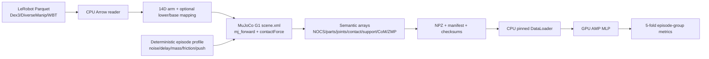

# 物理语义增强管线架构

本次实现聚焦“离线 G1_Action → G1 MJCF 物理语义 → GPU 训练/测试”，不连接真机。v2 产物额外保留完整 MuJoCo `qpos/qvel`、四路 IMU 传感器拼接值和 arm body world position。

## 层职责

| 层 | 责任 | 依赖边界 |
|---|---|---|
| 输入 | 读取状态、动作、episode/frame 元数据 | Arrow/Parquet |
| 映射 | 将不同数据集的双臂字段统一为 14 个 G1 hinge | NumPy |
| 仿真语义 | 设置 qpos/qvel/扰动，前向计算 body、接触、CoM/ZMP | MuJoCo |
| 扰动 | episode 固定 profile + frame 状态噪声/延迟/外力脉冲 | NumPy RNG |
| 写盘 | 固定 shape NPZ、profile JSON、源文件和产物 hash | NumPy/JSON |
| 训练 | fold-local normalization、AMP MLP、基线和指标 | PyTorch CUDA |
| 验证 | schema/shape/checksum/物理不变量 | Python 标准库 + NumPy |

## CPU/GPU 性能平衡

MuJoCo 的每帧物理语义具有顺序依赖，放在 CPU 可以避免频繁的 Python→GPU 小 kernel；Parquet 读取和 NPZ 压缩也保持 CPU。训练阶段按 4096 batch 使用 pinned memory、`non_blocking=True` 和 AMP，把吞吐密集的矩阵计算交给 RTX 5070。训练脚本只传递当前 batch 到显存，避免把全部 35 GB 原始数据或视频加载到 GPU。

## 一致性与可追溯

- 14 个 arm joint/body 名称来自 G1 `scene.xml`，不按数据集列顺序猜测。
- 每个 episode 用 `base_seed + dataset_id*10^7 + episode_index` 生成 profile；profile hash 写入 manifest。
- NPZ、配置、MJCF、源 Parquet 的 SHA-256 均写入 manifest 或实验结果。
- fold 分组键为 `dataset_id*1_000_000 + episode_index`，相邻帧不会被拆到不同训练/测试 fold。

## 当前范围的明确边界

没有实现 C++17/LibTorch C++ 目标、FlashAttention bridge、图像/深度渲染或 P-learning world-model。它们保留为后续模块输入；本次验收对象是物理语义数据和 GPU 交叉验证。
